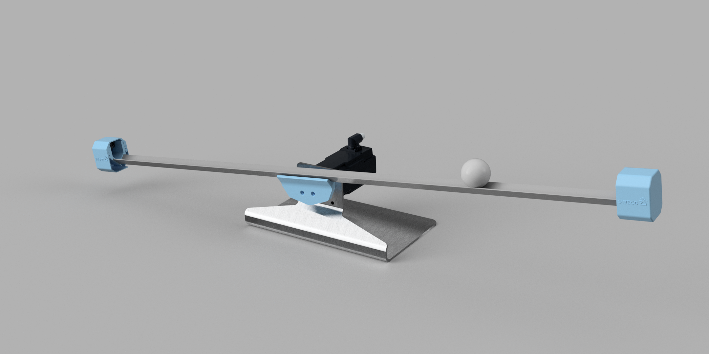
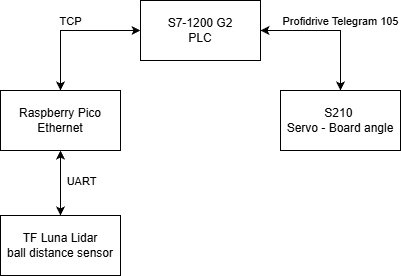
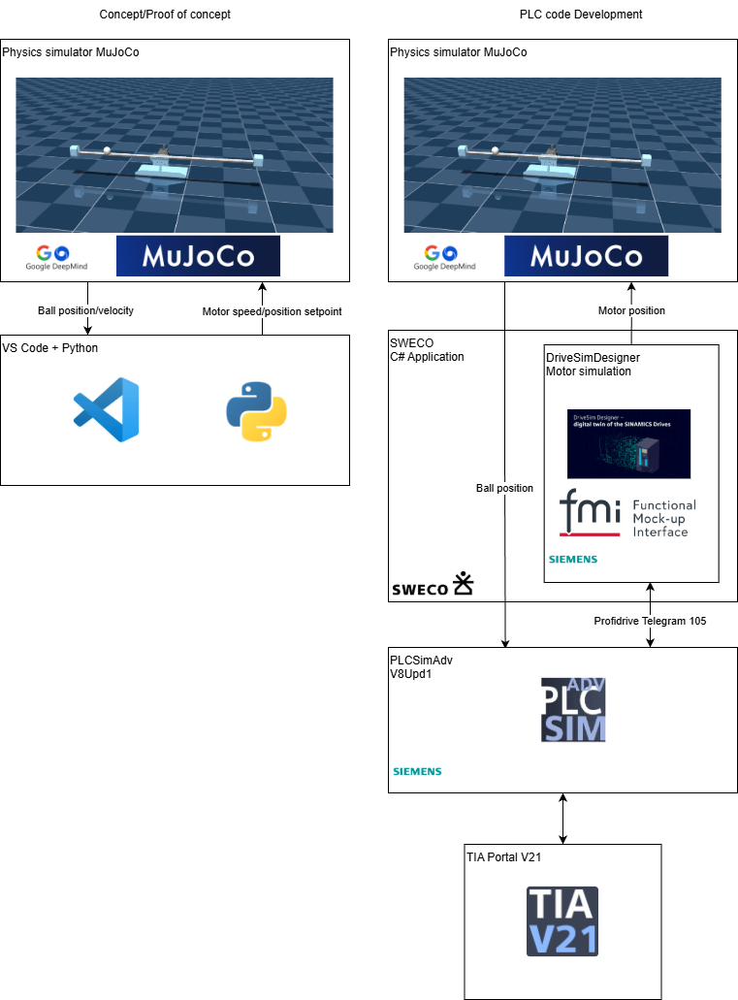

# Balance machine

This repo contains the PLC Code and Simulation for a ball balance machine. 




[Watch the real machine video](docs/videos/real_balance_vid.mp4)

The main hardware used are:
* Siemens S7-1200 G2 PLC
* Siemens S210 servo
* TF-Luna LiDAR distance sensor
* RP2350-ETH Microcontroller




## Control architecture

Ball position is $x$ and servo/board angle is $\theta$, the frame of reference is defined as


The ball position is controlled by a PID controller that outputs the servo angle, this is used for a proportional position controller for the servo position, the velcoity setpoint is then sent to the drive that runs the velocity control of the servo.


The architecutre is the same as a LQI controller, and that's how the initial gains were choosen. See `python\control_gains.ipynb` for more details regarding control design.

The trajectory generation is mainly to guarantee that the ball and servo stays within their dynamic limits, i.e. max acceleration, max velocity and software limits.


## Simulation

The most important part of this repo is the simulation.

The ball balance is done in mujoco, a physics simulator maintained by Google Deepmind. This is achieved by converting the CAD Assembly to the mujoco file format, which can be found in the `mujoco-robot` directory.

This makes it possible to prototype in python and interact directly with mujoco through its python library. This was how the control architecture was developed.

For the PLC Code, a custom C# application was developed that interacts with PLCSimAdv and mujoco. This is in the `simulation` directory

The servo dynamics and control-signals is simulated by the Simenes DriveSim Designer through an FMU.



[Watch the simulation video](docs/videos/sim-demo.mp4)

### Running the python simulation

You will need python, I've been using `3.13.0`.

```shell
pip install numpy
pip install matplotlib
pip install mujoco
cd python
python mujoco_sim.py
```

### Running the PLC simulation

You will need the toolchain for C# and follow the instructions for the PLCSimAdv API [https://support.industry.siemens.com](https://support.industry.siemens.com/cs/document/109997789/s7-plcsim-advanced-function-manual-api?dti=0&lc=en-SE)

1. Get the FMU's from Siemens [https://www.siemens.com/en-us/products/digital-drivetrain/](https://www.siemens.com/en-us/products/digital-drivetrain/drivesim-designer/)
2. Copy `Siemens.Simatic.Simulation.Runtime.Api.x64.dll` from your TIA Install to the `simulation folder`.
3. Download the TIA project to PLCSimAdv 8.1
4. Go into the `simulation` directory and run `dotnet build`
5. Run `.\bin\Debug\net48\sim-balance.exe`


## RP2350 Firmware

The RP2350 acts as a middelayer between the distance sensor and PLC. Its micro-python code is located in the `rp2350-firmware` folder.

For more info about the RP2350, see [https://www.waveshare.com/wiki/RP2350-ETH](https://www.waveshare.com/wiki/RP2350-ETH)

The distance sensor communicates with the RP2350 through UART, where the position value then is transmitted to the PLC through standard TCP.

A fun fact, using the TCP adapter option in PLCSimAdv, its possible to test the TCP communication in simulation.

