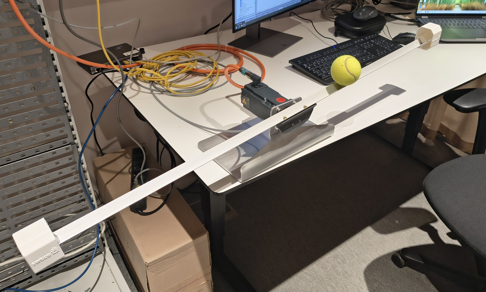
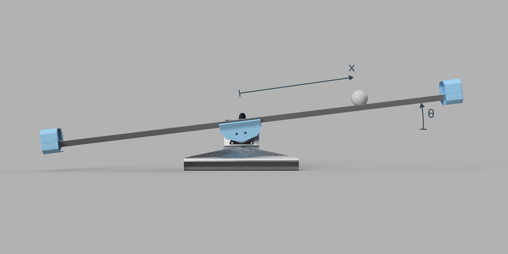
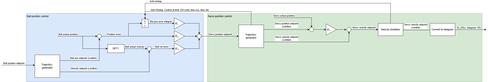

# Balance machine

This repo contains the PLC code and simulation for a ball balance machine.




https://github.com/user-attachments/assets/cc02a76b-089c-4ac8-9cfb-12c7500d12f7

The main hardware used is:
* Siemens S7-1200 G2 PLC
* Siemens S210 servo
* TF-Luna LiDAR distance sensor
* RP2350-ETH microcontroller


## Control architecture

Ball position is $x$ and servo/board angle is $\theta$. The frame of reference is defined as:



The ball position is controlled by a PID controller that outputs the servo angle. This is used by a proportional position controller for the servo position. The velocity setpoint is then sent to the drive that runs the velocity control of the servo. (I'm sure it would be possible to use the Dynamic Servo Control to improve this)



The architecture is the same as an LQI controller, and that's how the initial gains were chosen. See `python\control_gains.ipynb` for more details regarding control design.

The trajectory generation is mainly to guarantee that the ball and servo stay within their dynamic limits, i.e. maximum acceleration, maximum velocity and software limits.


## Simulation

The most important part of this repo is the simulation.

The ball balance is simulated in MuJoCo, a physics simulator maintained by Google DeepMind. This is achieved by converting the CAD assembly to the MuJoCo file format, which can be found in the `mujoco-robot` directory.

This makes it possible to prototype in Python and interact directly with MuJoCo through its Python library. This was how the control architecture was developed.

For the PLC code, a custom C# application was developed that interacts with PLCSimAdv and MuJoCo. This is in the `simulation` directory.

The servo dynamics and control signals are simulated by Siemens DriveSim Designer through an FMU.


https://github.com/user-attachments/assets/7bfbd1fe-b75a-4847-a7e6-ed2d5c6ac8c3

### Running the Python simulation

You will need Python, I've been using `3.13.0`.

```shell
pip install numpy
pip install matplotlib
pip install mujoco
cd python
python mujoco_sim.py
```

### Running the PLC simulation

You will need the C# toolchain and should follow the instructions for the PLCSimAdv API at [https://support.industry.siemens.com](https://support.industry.siemens.com/cs/document/109997789/s7-plcsim-advanced-function-manual-api?dti=0&lc=en-SE).

1. Get the FMUs from Siemens: [https://www.siemens.com/en-us/products/digital-drivetrain/](https://www.siemens.com/en-us/products/digital-drivetrain/drivesim-designer/).
2. Copy `Siemens.Simatic.Simulation.Runtime.Api.x64.dll` from your TIA installation to the `simulation` folder.
3. Download the TIA project to PLCSimAdv 8.1.
4. Go into the `simulation` directory and run `dotnet build`.
5. Run `.\bin\Debug\net48\sim-balance.exe`.


## RP2350 Firmware

The RP2350 acts as a middle layer between the distance sensor and PLC. Its MicroPython code is located in the `rp2350-firmware` folder.

For more info about the RP2350, see [https://www.waveshare.com/wiki/RP2350-ETH](https://www.waveshare.com/wiki/RP2350-ETH).

The distance sensor communicates with the RP2350 through UART, where the position value then is transmitted to the PLC through standard TCP.

A fun fact: using the TCP adapter option in PLCSimAdv, it's possible to test the TCP communication in simulation.

